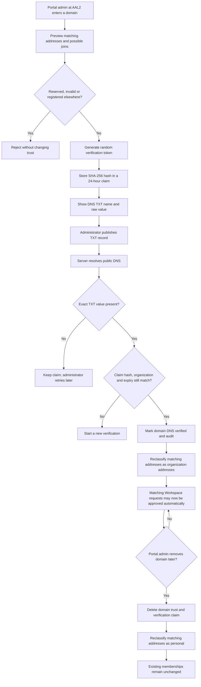
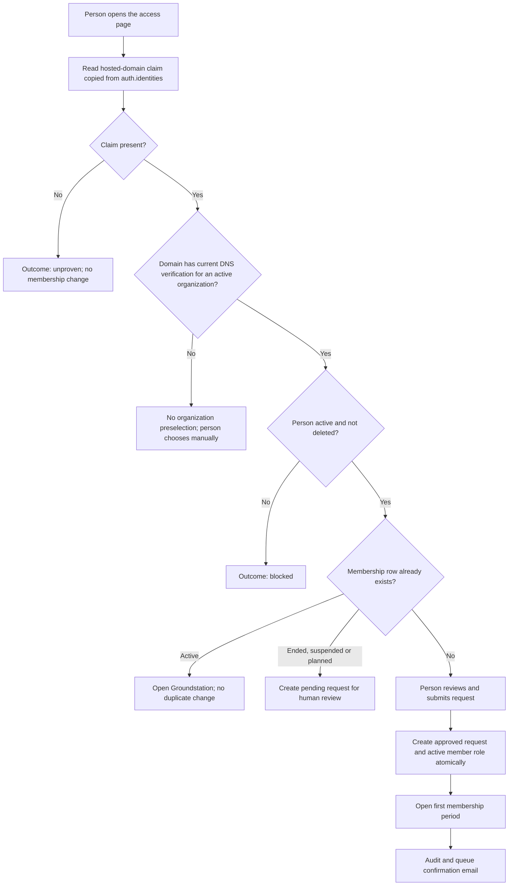
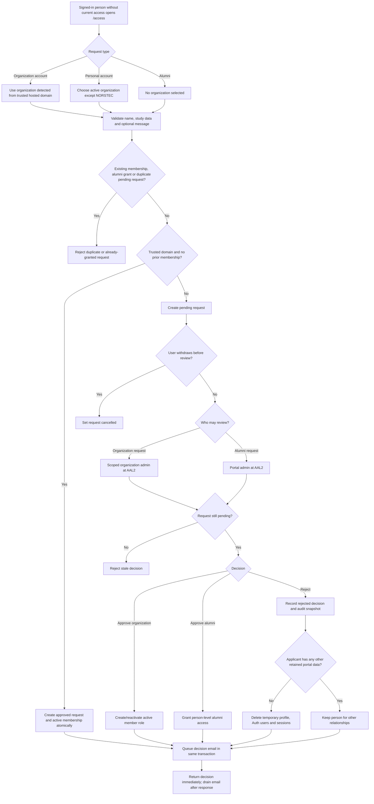
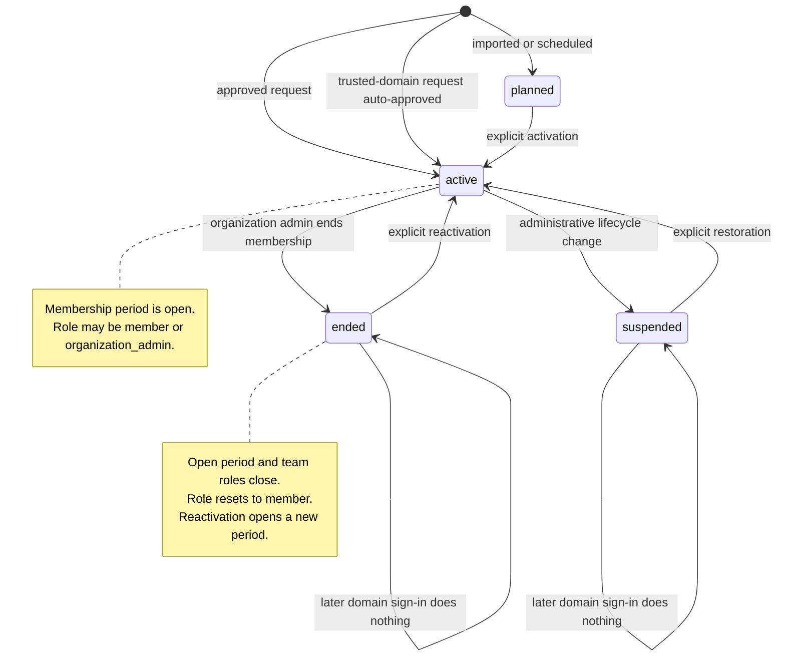
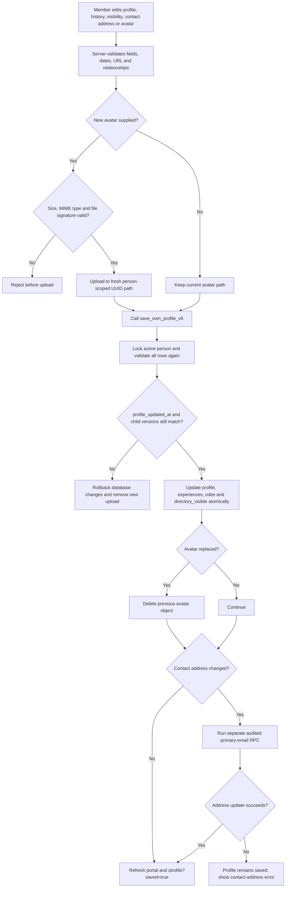
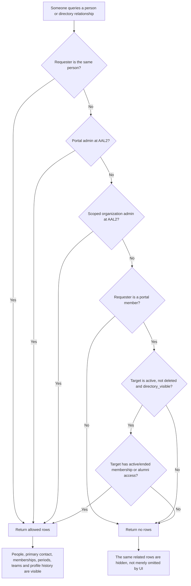
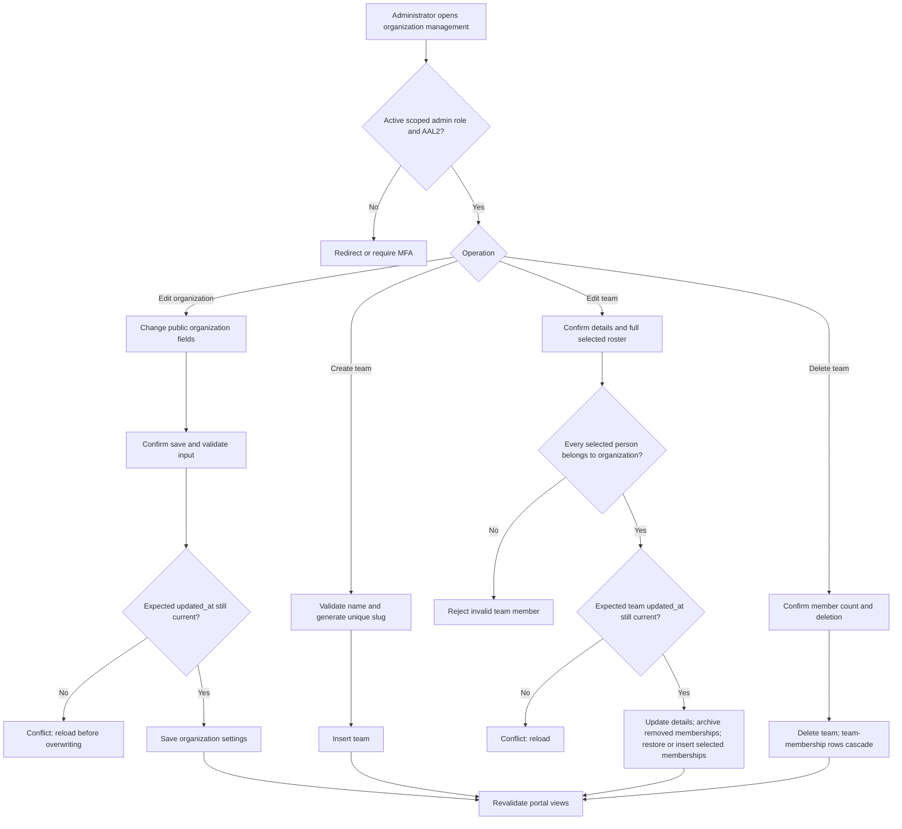

# Membership and directory flows

## Verify or remove an organization domain

Domain ownership is a portal-admin operation. It never approves individual
people.

## Trusted-domain access request

Google's hosted-domain claim detects the organization. It never creates a
membership at sign-in; the person must submit the request first. An existing
membership always outranks automatic approval.

## Access request and review

## Membership lifecycle

## Save own profile

## Directory visibility

Every related table applies the same person decision through RLS.

## Organization and team administration

